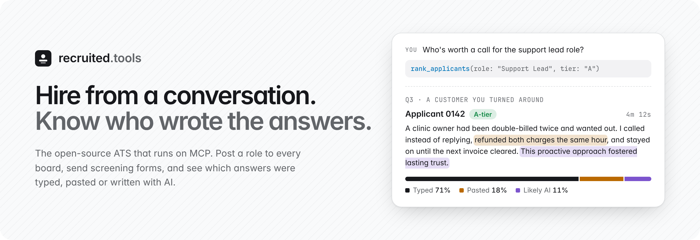

<picture>
  <source media="(prefers-color-scheme: dark)" srcset="brand/github-graphics/banner-dark.png">
  
</picture>

# Recruited

An open-source applicant tracking system for the people hiring, built to run from a conversation over MCP. It's the employer-side sibling of [Hired](https://github.com/shifulaboratories/Hired), the ATS for applicants.

You tell Claude what you're hiring for. It writes the job, an application form, and a listing for each board you post on, each in that board's own format with its own apply link. Applicants fill in the form, and every written answer records how it got there: typed, pasted, or filled in some other way, plus a "likely written with AI" label when the writing shows the usual signs. You read the pipeline in the app, or ask Claude who's worth a call.

## What's in it

- **Board guides** for LinkedIn, Indeed, OnlineJobs.ph, Wellfound, Upwork and your own careers page: length limits, how pay is stated, what gets a listing rejected, where the apply link goes. Claude reads the guide before writing each listing, and the listing is checked against it.
- **One apply link per listing.** Two listings of one job on one board are an A/B test; `listing_report` compares them on applicants who met the must-haves, not on raw volume.
- **Forms** with must-have (knockout) questions and file questions (a setup photo, a speed-test screenshot, a PDF), and screening forms sent to a shortlisted applicant through a personal link. Files are kept in Postgres, so there's still nothing to configure, and Claude can open them with `read_upload`.
- **Answer provenance.** The form counts characters by how they arrived, using the browser's own input types, and notes a paste that comes right after the applicant left the page. It stores counts and timings, never keystrokes, and the form says so. Style signals are a separate, weaker hint and always say "likely".
- **Tiers and ranking.** `rank_applicants` proposes an A, B or C tier and a rank for each applicant, with a reason you can check, following the job's own rubric. You accept or change it in the app; a tier you decided is never overwritten. `listing_report` counts A-tier applicants and their cost per listing.
- **22 MCP tools and 2 prompts** (`post_a_role`, `review_applicants`). The app has the screens a person needs to look and adjust: jobs, applicants, one applicant's answers, and Connect Claude.

## Connect your AI

Sign in, open **Connect Claude**, copy the URL, and add it in Claude as a custom connector. Then: "I'm hiring an operations VA, full time, PHP 30–40k a month. Post it on OnlineJobs.ph and LinkedIn."

## Running it locally

Postgres and Node 20 or later.

```bash
echo 'DATABASE_URL="postgresql://…/recruited"' > .env
npm install
npx prisma migrate deploy
npm run build && npm start
```

`DATABASE_URL` is the only setting. On first start the server prints an owner email and password once; change both under Connect Claude → Your account.

## Working on it

Read [CLAUDE.md](CLAUDE.md) first. The plan and what's next are in [docs/PLAN.md](docs/PLAN.md); the brand is in [brand/BRAND.md](brand/BRAND.md).

License: AGPL-3.0.
